<table  width="100%" align="center">
<tr>
<td>

 

<h1 >👋 Olá! Eu sou <b>Arthur Jardim</b></h1>

Bem-vindo ao meu perfil! 
Sou um desenvolvedor curioso de tecnologia, sempre buscando aprender mais e criar projetos interessantes.

<h2>Sobre mim</h2>

<ul>
  <li>Estudante e desenvolvedor de backend</li>
  <li>Focado em Java</li>
  <li>Sempre aprendendo algo novo</li>
  <li>Curto criar projetos organizados e bem estruturados</li>
</ul>

## 🎮 Minhas contribuições

<picture>
  <source media="(prefers-color-scheme: dark)" srcset="https://raw.githubusercontent.com/jardim-arthur/jardim-arthur/output/pacman-contribution-graph-dark.svg">
  <source media="(prefers-color-scheme: light)" srcset="https://raw.githubusercontent.com/jardim-arthur/jardim-arthur/output/pacman-contribution-graph.svg">
  
</picture>

## 🚀 Tecnologias que eu mais utilizo

  

 

## 🔥 Sequência de dias 

<table  width="100%" align="center">
<tr>
<td align="center">

</td>
</tr>
</table>

 

</td>
</tr>
</table>

